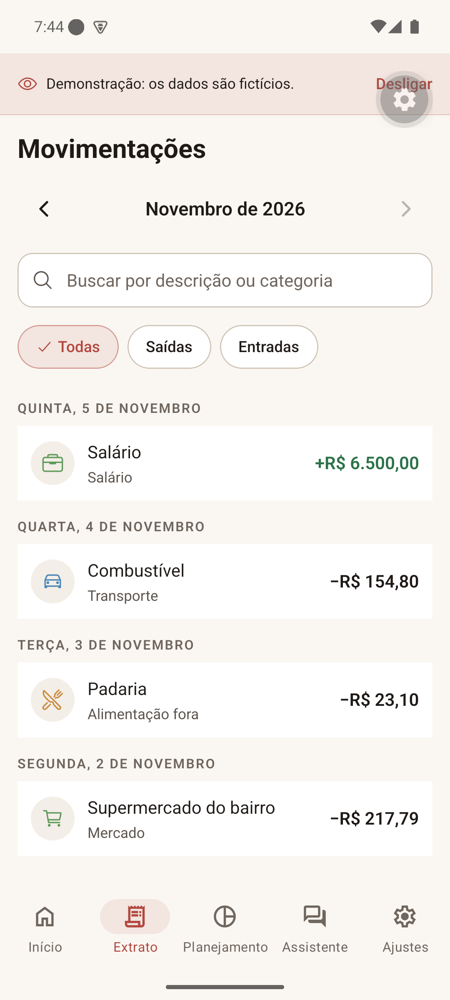
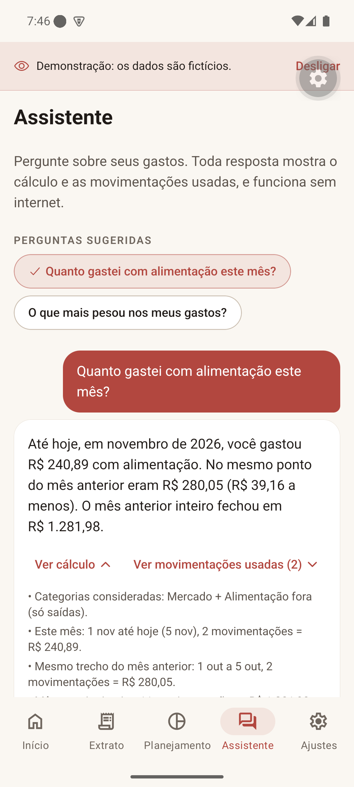

# Hamm — Dr. Porcão

**Finanças pessoais e da família, de graça, sem anúncios e sem entregar seus dados a ninguém.**

Hamm é um app de código aberto para Android e iPhone que organiza o seu dinheiro e tem uma assistente que **explica cada número**: de onde veio o total, qual foi o cálculo e quais movimentações entraram nele. Tudo funciona **sem internet** e fica guardado **no seu celular**.

A ideia nasceu da saudade de uma assistente financeira que existia no Brasil: ela olhava o histórico, percebia hábitos, avisava de mudanças e ajudava a planejar, conversando em português. O Hamm recupera essa experiência com identidade própria e com uma regra que não muda: **o dono dos dados é você**.

> **Estado atual:** em desenvolvimento, Fase 1 de 7 (fundação). Ainda não registra movimentações reais. Veja o [roadmap](docs/ROADMAP.md).

<p align="center">
  
  
  
  
</p>
<p align="center"><sub>Telas com dados fictícios da demonstração.</sub></p>

## O que o Hamm quer ser

- **Assistente que não inventa número.** As respostas são calculadas no aparelho, com "ver cálculo" e "ver movimentações usadas". Fato é fato ("você gastou R$ X"), previsão é previsão ("se mantiver esse ritmo…"). Inteligência artificial externa será opcional, com a sua própria chave, e só para conversar: quem soma é o app.
- **Modo família com privacidade de verdade.** Cada pessoa tem o seu app, os seus dados e as suas senhas. Tudo é **privado por padrão**; você escolhe, por conta ou por transação, o que a família vê. O compartilhamento vai **cifrado** para uma pasta do Google Drive da própria família, sem servidor no meio.
- **Grátis no essencial, para sempre.** Lançar gastos, importar extratos (CSV/OFX), categorizar, ver relatórios, usar a assistente, fazer backup e restaurar: nada disso será pago.
- **Offline primeiro.** Internet só para o que você ligar: backup no Drive, sincronização da família, conexão com banco (Open Finance pessoal, opcional) ou IA externa.
- **Backup seu, cifrado com a sua senha.** Separado do que é compartilhado com a família. Restaura do Android para o iPhone e vice-versa.
- **Dinheiro levado a sério.** Valores em centavos inteiros (nada de arredondamento esquisito), pagamento de fatura não conta como gasto de novo, estorno reduz a despesa certa, parcela não é duplicada.

## O que já funciona (Fase 1)

- Cadastro em 3 passos: nome, PIN (de 4 a 8 números, você escolhe) e preferências (dia em que o seu mês começa, fuso horário, categorias).
- Bloqueio por PIN e por digital/rosto, com espera crescente depois de 5 tentativas erradas (fechar o app não zera a espera).
- Opção de **impedir prints e gravação de tela**.
- Tela coberta na lista de apps recentes.
- Cinco abas: Início, Extrato, Planejamento, Assistente e Ajustes.
- **Demonstração** com dados fictícios para ver como o app vai ficar, sem gravar nada.
- Categorias que você inclui, renomeia, troca ícone e cor ou tira como quiser.
- Tema claro, escuro ou igual ao do celular; fonte do tamanho que o celular pedir.

## Roadmap

| Fase | Entrega |
|---|---|
| 0 | Planejamento, arquitetura e decisões ✅ |
| 1 | Fundação: cadastro, PIN, bloqueio, abas, demonstração ✅ (em validação) |
| 2 | Contas, cartões, faturas, parcelas, transferências, importação CSV/OFX |
| 3 | Backup cifrado (arquivo e Google Drive) e restauração entre Android e iPhone |
| 4 | Orçamento, metas, recorrências e a assistente respondendo com os seus dados — **fecha o MVP pessoal** |
| 5 | Modo família: convites, compartilhamento seletivo e sincronização cifrada pelo Drive |
| 6 | Integrações opcionais: Open Finance pessoal (Pluggy) e IA com a sua chave |
| 7 | Releases assinadas e guias completos |

Detalhes em [docs/ROADMAP.md](docs/ROADMAP.md), [docs/ARQUITETURA.md](docs/ARQUITETURA.md) e [docs/DECISIONS.md](docs/DECISIONS.md). A especificação original está em [docs/product/ESPECIFICACAO.md](docs/product/ESPECIFICACAO.md).

## Como instalar

O Hamm **não está e não estará nas lojas**. Ele fica aqui no GitHub para quem quiser usar, estudar e modificar.

**Para testar hoje (Android ou iPhone), sem compilar nada no celular:**

1. Instale o [Node.js](https://nodejs.org/) (versão 22 ou mais nova) no computador.
2. No celular, instale o **Expo Go** (Play Store ou App Store).
3. No computador:
   ```bash
   git clone https://github.com/JonnyYamagushi/hamm.git
   cd hamm/mobile
   npm install
   npx expo start
   ```
4. Com o celular na mesma rede Wi-Fi, leia o QR code (iPhone: câmera; Android: dentro do Expo Go).

No Expo Go, alguns recursos ficam indisponíveis (banco cifrado, login do Google, Face ID). O app mostra o que funciona em **Ajustes › Sobre este aparelho**. As próximas fases trarão APK pronto para Android; no iPhone, um app instalado de verdade exige compilar com uma conta de desenvolvedor Apple (o build pode ser feito na nuvem pelo EAS, sem Mac).

## Para quem programa

- **Stack:** React Native + Expo + TypeScript + Expo Router; SQLite local com **SQL explícito** (sem ORM); migrations por `PRAGMA user_version`; Jest (com SQLite real via `node:sqlite`).
- **Arquitetura:** `domain` (regras puras) → `application` (casos de uso e interfaces) → `infrastructure` (SQLite, armazenamento seguro, biometria) → `ui`/`app` (telas). Ver [mobile/README.md](mobile/README.md).
- **Validação:** `npx tsc --noEmit`, `npx expo lint`, `npx jest` e `npx expo-doctor`, também no CI.
- **Fork:** nome, identificadores e (no futuro) credenciais públicas ficam em configuração. **Nunca** coloque senhas, tokens ou chaves no repositório.

Sugestões e correções são bem-vindas: abra uma *issue* descrevendo o problema ou a ideia antes de um *pull request* grande.

## Privacidade e segurança

- Sem anúncios, sem rastreamento, sem enviar dados financeiros para servidor nenhum.
- PIN guardado como hash no armazenamento seguro do sistema (Keychain/Keystore), nunca no banco.
- Encontrou uma falha de segurança? Leia [SECURITY.md](SECURITY.md) e avise em particular, sem abrir issue pública.

## Apoie o desenvolvimento

O Hamm é feito no tempo livre e será sempre gratuito. Se ele te ajudar e você quiser contribuir com o desenvolvimento, use o botão **Sponsor** no topo desta página (GitHub Sponsors). Apoiar é totalmente opcional e não libera nenhum recurso extra: tudo continua igual para todo mundo.

Outras formas de ajudar: testar, relatar problemas, sugerir melhorias e espalhar a ideia.

## Avisos

- O Hamm não tem relação com bancos, instituições financeiras, outros apps de finanças, marcas ou personagens de terceiros. O nome é provisório.
- Não é consultoria financeira: as sugestões são cálculos sobre os seus próprios dados.

## Licença

[MIT](LICENSE).
