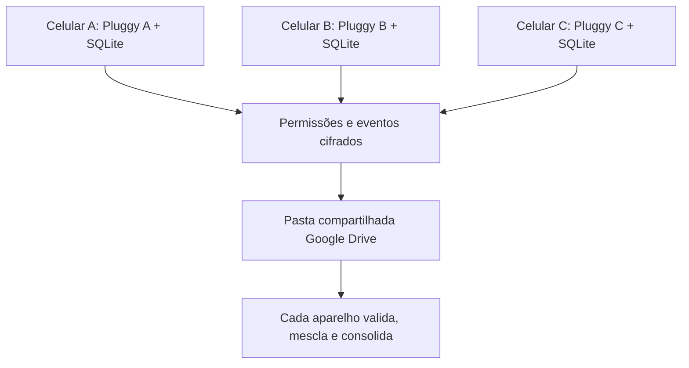

# Especificação técnica e funcional — Hamm — Dr. Porcão (Financeiro Familiar Open Source)

> Documento para implementação com Claude Code ou outra IA de desenvolvimento.  
> Versão: 1.2 — 26/10/2026.  
> Idioma: português brasileiro.  
> Status: especificação de um produto novo, a ser implementado do zero em repositório próprio.

## 0. Instruções para o Claude (leia primeiro)

Você atuará como **arquiteto de software, product designer, engenheiro mobile e especialista em segurança de dados financeiros**. Quero **criar do zero um aplicativo de controle financeiro pessoal e familiar** gratuito, configurável, open source, para Android e iPhone, inspirado na proposta de valor da antiga assistente financeira Olivia (adquirida pelo Nubank). O nome provisório é **Hamm — Dr. Porcão**.

1. **Inicie um projeto novo.** Defina stack, estrutura de pastas, banco de dados, domínio financeiro, navegação, autenticação local, testes e documentação a partir dos requisitos deste arquivo. Use uma arquitetura simples, robusta e evolutiva.
2. Entregue primeiro `ARQUITETURA.md`, `ROADMAP.md` e um ADR explicando as escolhas técnicas. Em seguida, implemente por etapas testáveis, começando por uma aplicação executável com dados fictícios.
3. Se ainda não houver repositório, proponha a estrutura, inicialize o projeto e documente os comandos necessários. Escolha defaults seguros e evite dependências pagas obrigatórias.
4. **Objetivo central:** aplicativo usável totalmente de graça nas funções essenciais, offline-first, com modo pessoal e familiar, sincronização familiar criptografada pelo Drive sem servidor próprio obrigatório, sem publicidade, assinatura ou IA paga. Recursos de terceiros opcionais devem ser claramente marcados como opcionais e sujeitos a custos ou termos próprios.
5. Faça código de produção com testes, acessibilidade, documentação, tratamento de erros, segurança e scripts de build. Não entregue só mockups.
6. Para decisões estruturais, explique trade-offs e peça autorização antes de ações irreversíveis, antes de alterar infraestrutura externa, publicar lojas ou transmitir dados financeiros reais.
7. Mantenha decisões e progresso no repositório (`docs/`, issues ou checkpoints). Trabalhe em entregas pequenas com critérios de aceite e instruções reproduzíveis.

## 1. Visão do produto

**Nome provisório:** **Hamm — Dr. Porcão** (identidade sujeita a pesquisa de marca e revisão jurídica antes da publicação; não utilizar o visual/personagem de Toy Story, nem marca/imagens/voz/traços reconhecíveis da Disney/Pixar).  
**Proposta:** um assistente financeiro pessoal **e familiar** aberto, gratuito e configurável, que reúne dados de titulares distintos somente quando autorizados, entende padrões de despesas e ajuda a família a planejar sem perder a privacidade individual.  
**Público:** indivíduos e famílias (referência inicial: três membros — usuário, esposa e filha), com instalações independentes em seus próprios aparelhos e sem compartilhar credenciais entre titulares.  
**Plataformas:** Android e iOS, com uma base compartilhada de código.  
**Mercado inicial:** Brasil; moeda padrão BRL; pt-BR; fuso configurável, inicialmente `America/Sao_Paulo`.

### Princípios inegociáveis

- Código-fonte público no GitHub sob licença open source permissiva (avaliar MIT/Apache-2.0 e compatibilidade das dependências); dados e credenciais nunca no GitHub.
- Sem cobrança para registrar gastos, importar arquivos, categorizar, consultar relatórios, usar a assistente básica, fazer backup e restaurar.
- Funcionalidade principal offline; conexão à internet somente para integrações, backup remoto, atualização e eventual IA externa opcional.
- O usuário controla onde seus dados ficam, exporta e exclui suas informações e consegue transferi-las entre Android e iPhone.
- **Compartilhamento seletivo por conta e por transação:** tudo privado por padrão; cada titular escolhe explicitamente o que entra na visão familiar. Nunca compartilhar automaticamente todos os lançamentos ao ingressar no grupo.
- Cada membro é dono de suas próprias conexões bancárias, chaves e consentimentos. Dados familiares trafegam criptografados; credenciais de APIs bancárias nunca trafegam pelo cofre compartilhado.
- Backup privado individual e sincronização compartilhada são mecanismos distintos, com chaves, destinos e políticas próprias.
- Arquitetura extensível por adaptadores para provedores de dados, backup e IA; evitar dependência obrigatória de um único serviço.
- Segurança e privacidade desde o desenho, com criptografia, mínimo privilégio, consentimento e configurações transparentes.
- **Inspiração na experiência Olivia, sem copiar marca, logotipo, textos proprietários, identidade visual ou código.**

## 2. Inspiração funcional: uma “nova Olivia”, com identidade própria

Recuperar **a experiência de assistente financeiro proativo e conversacional**: interpretar histórico de transações, reconhecer hábitos e recorrências, detectar mudanças de padrão, prever compromissos e sugerir melhorias. No antigo produto, a interação era feita por chat e notificações personalizadas, mediante aceite do usuário.

### Personalidade e UX da assistente

- Tom acolhedor, humano, objetivo e sem julgamento, em pt-BR.
- Explicar **por que** gerou cada insight, citando transações/períodos relevantes; nunca inventar dados ou totais.
- Diferenciar fatos (“você gastou R$ X”) de previsões (“se mantiver esse ritmo…”).
- Nunca executar exclusões, transferências, pagamentos ou recategorizações em lote sem confirmação explícita.
- Priorizar sugestões práticas, não aconselhamento financeiro regulado ou promessas de rentabilidade.
- Conversas com histórico local e opção de limpar histórico separadamente dos lançamentos.
- Notificações úteis e configuráveis, sem spam ou manipulação emocional.

### Exemplos de perguntas e respostas esperadas

1. “Quanto gastei com alimentação este mês?” → total correto, intervalo, comparação com mês anterior, lista de transações auditável.
2. “O que aumentou meus gastos?” → ranking de categorias/estabelecimentos, variação absoluta e relativa, com fontes.
3. “Vou conseguir pagar as próximas faturas?” → projeção transparente baseada em saldo informado, renda e compromissos conhecidos; alertar sobre dados ausentes.
4. “Quais assinaturas eu tenho?” → identificar recorrências candidatas e permitir confirmar/ignorar.
5. “Como economizar R$ 300 no próximo mês?” → sugestões parametrizadas e estimativas, sem prometer resultado.
6. “Essa compra é diferente do meu padrão?” → cálculo baseado em histórico suficiente, com sensibilidade configurável.
7. “Quanto a família gastou este mês?” → total **somente das transações compartilhadas**; mostrar membros incluídos, contas/período e dados ainda não sincronizados.
8. “Quanto eu gastei sem contar os gastos compartilhados?” → filtrar titular, visibilidade e categorias corretamente, sem contar duas vezes uma transferência familiar.

## 3. Escopo por prioridade

| Prioridade | Entrega | Requisito principal |
|---|---|---|
| P0 / MVP | Fundação | Estruturar um aplicativo novo, com domínio financeiro testável e armazenamento local |
| P0 / MVP | App Android/iOS | Interface responsiva, acessível e compartilhada |
| P0 / MVP | Offline | Cadastrar e consultar movimentações sem rede |
| P0 / MVP | Finanças essenciais | Contas, cartões, receitas, despesas, transferências, categorias, tags, parcelas, faturas |
| P0 / MVP | Importação | CSV/OFX; PDF somente se houver parser confiável, com prévia e conferência |
| P0 / MVP | Backup | Backup criptografado, automático quando possível, e restauração em ambos os sistemas |
| P0 / MVP | Identidade familiar | Criar/entrar em família, perfis e dispositivos, convite seguro, papéis e revogação |
| P0 / MVP | Privacidade seletiva | Compartilhar por conta e por transação; privado por padrão; revisar compartilhamentos |
| P0 / MVP | Sincronização familiar | Pasta compartilhada no Drive, eventos criptografados, multiwriter, deduplicação e conflitos |
| P0 / MVP | Backup privado separado | Cada titular guarda a sua cópia privada, sem incluí-la na pasta de sincronização |
| P0 / MVP | Segurança | Bloqueio por biometria/PIN, segredos protegidos, exportar/excluir dados |
| P0 / MVP | Assistente básica | Perguntas frequentes e insights calculados localmente, sem API de IA paga |
| P0 / MVP | GitHub | Repositório público documentado, parametrizável e com builds/testes |
| P1 | Bancos | Adaptador de Open Finance/Pluggy pessoal quando permitido e configurado pelo próprio usuário |
| P1 | Inteligência financeira | Padrões, assinaturas, orçamento, alertas, previsões, metas |
| P1 | Assistente conversacional avançada | Compreensão de linguagem natural e camada opcional de LLM com consentimento |
| P1 | Relatórios | Comparações, filtros, calendário de faturas, exportação de relatórios |
| P1 | iCloud e outros provedores | Adaptadores de backup adicionais, após opção portátil validada |
| P2 | Sincronização avançada | Otimização, histórico seletivo, compartilhamento de anexos e resolução colaborativa de conflitos complexos |
| P2 | OCR | Leitura de comprovantes, com revisão antes de salvar |
| P2 | Widgets | Resumo de orçamento, próximos vencimentos, alertas discretos |

O MVP precisa ser **completo e útil sem qualquer conexão bancária**; nunca bloquear o lançamento manual ou a importação de arquivos porque um agregador não foi contratado.

## 4. Telas e fluxos

### Navegação sugerida

Tabs inferiores: **Início**, **Movimentações**, **Planejamento**, **Assistente**, **Ajustes**. Ações rápidas: adicionar gasto, receita, transferência, importar arquivo e realizar backup.

1. **Onboarding:** apresentação curta; criar perfil individual; “usar offline” como opção padrão; criar PIN/habilitar biometria; escolher moeda, início do mês, categorias; oferecer **Criar família** ou **Entrar com convite** e configurar Drive com autorização separada para sincronização familiar e backup pessoal. Integração bancária continua opt-in específico por titular.
2. **Início:** alternar **Minha visão** ↔ **Família**; saldo e despesas do período, orçamento, faturas e insights; na visão familiar, somar somente dados compartilhados e mostrar data/origem da última atualização por membro.
3. **Movimentações:** busca, filtros de titular/cartão/conta/período/categoria/status/origem/visibilidade, agrupamento por dia, detalhe, edição manual com rastreabilidade, transação duplicada sinalizada; controles “Privado”/“Compartilhar com família” por item.
4. **Contas e cartões:** saldos, limite, fechamento/vencimento, faturas abertas/fechadas, parcelas futuras e histórico.
5. **Planejamento:** orçamento por categoria, metas, recorrências, compromissos futuros, previsão mensal e cenários simples.
6. **Assistente:** chat + cartões de insights. Cada resultado financeiro tem opção “ver cálculo” e “ver movimentações usadas”. Funcionamento básico sem internet.
7. **Ajustes:** aparência, idioma, membros e permissões da família, fontes de dados, contas compartilhadas, regras por transação, integrações bancárias individuais, status do Drive familiar, backup privado/restore, exportar/apagar dados, diagnóstico e créditos open source.

### Design

- Visual original: limpo, atual, acolhedor, com cards de insights, gráficos discretos, excelente tipografia e modo claro/escuro/sistema.
- Não copiar o visual original da Olivia nem de aplicativos bancários.
- Mascote opcional de **porquinho conselheiro financeiro**, desenho, roupas, personalidade, voz e traços **totalmente originais**, sem associação visual ou comunicação oficial com Hamm de Toy Story/Disney/Pixar; manter o nome provisório até a pesquisa de disponibilidade e análise de marca.
- Suporte a fontes ampliadas, leitores de tela, contraste WCAG AA onde aplicável, área de toque confortável, labels acessíveis, animações reduzidas.
- Não exibir informações financeiras sensíveis em notificações ou tela de aplicativos recentes sem consentimento específico.
- Estados completos: inicial, vazio, carregando, offline, erro, permissão negada, sincronização parcial e restaurando backup.

## 5. Arquitetura de referência

**Stack preferencial para o novo projeto:** **React Native + Expo + TypeScript**, roteamento pelo Expo Router, armazenamento local SQLite e módulos bem definidos. Avalie versões estáveis, compatibilidade entre Android e iOS, recursos nativos de backup e criptografia e justifique qualquer alternativa tecnológica.

```text
UI mobile (Android/iOS)
  └─ Presentation / View Models
      └─ Casos de uso (finanças, IA, importação, backup)
          ├─ Repositórios (interfaces)
          │   └─ SQLite local + versionamento de esquema
          ├─ Importadores (CSV, OFX, PDF validado)
          ├─ Conector bancário individual por titular (opt-in)
          ├─ FamilySharingService (permissões por conta/transação)
          │   └─ EncryptedEventSync → pasta Drive familiar compartilhada
          ├─ PersonalBackupProvider (Drive pessoal, arquivo local, iCloud opcional)
          └─ Assistente (motor determinístico; LLM opcional)
```

### Regras de arquitetura

- Domínio independente de UI, banco e provedores; interfaces/adapters + dependency injection moderada.
- SQLite transacional local como fonte primária no MVP; armazenamento sensível protegido por criptografia em repouso (avaliar SQLCipher e suporte real da stack escolhida).
- UUIDs locais estáveis; timestamps UTC persistidos e formatação na timezone do usuário; dinheiro em **centavos inteiros ou decimal exato**, nunca `float` para cálculo monetário.
- Camada `FinanceRepository` com métodos explícitos, evolução versionada do esquema, constraints e testes.
- Separar **backup** de **sincronização multi-dispositivo**. No MVP, garantir recuperação e transferência entre aparelhos, não edição simultânea irrestrita.
- Preparar `DataSourceAdapter`, `BackupProvider`, `AssistantEngine`, `ImportParser`, `CategoryRuleEngine` para substituição sem refatorar o app inteiro.
- Cada aparelho mantém seu **SQLite local** e sincroniza somente eventos explicitamente compartilhados com uma **pasta familiar criptografada**. Não subir uma cópia única e mutável do SQLite para todos editarem.
- Eventos familiares append-only, identificadores globais, operação idempotente, checkpoint de leitura e marcação de conflito; novas versões podem compactar eventos em snapshots sem perder histórico necessário.
- Separar criptografia/chave de **backup pessoal** da criptografia/chave da **família**. Nenhuma credencial Pluggy, token OAuth ou chave privada vai para o Drive compartilhado.
- Preparar `FamilySyncAdapter`, `PersonalBackupProvider`, `SharingPolicy` e `ConflictResolver`; não depender de um servidor próprio para sincronização básica entre três aparelhos.
- Backend remoto **não é obrigatório** para o MVP. Se futuramente necessário para integração de segredos, comunicação entre dispositivos ou webhooks, criar serviço opcional documentado e self-hostable, não requisito para uso offline.

### Estrutura sugerida do repositório

```text
apps/mobile/
packages/domain/
packages/data/
packages/importers/
packages/assistant/
packages/backup/
packages/family-sync/
packages/permissions/
packages/integrations/
services/optional-connector/     # somente se necessário
docs/architecture/
docs/security/
docs/product/
tests/
.github/workflows/
README.md
CONTRIBUTING.md
SECURITY.md
PRIVACY.md
LICENSE
.env.example
```

Mantenha a estrutura de projeto enxuta; só adote monorepo se ele trouxer benefício concreto para o código compartilhado e os adaptadores.

## 6. Modelo de dados inicial

**Entidades mínimas:** `profiles`, `families`, `family_members`, `family_invites`, `devices`, `family_key_envelopes`, `accounts`, `account_sharing_policies`, `transaction_sharing_grants`, `credit_cards`, `card_bills`, `transactions`, `installment_plans`, `categories`, `category_rules`, `budgets`, `goals`, `recurrences`, `data_connections`, `imports`, `sync_events`, `sync_cursors`, `sync_conflicts`, `backup_manifests`, `assistant_insights`, `assistant_messages`, `app_settings`.

Campos/regras relevantes:

- `profiles`: `id`, nome/apelido, dispositivo(s), configurações de privacidade, status local. Identidade individual distinta de autenticação Google e de conta Pluggy.
- `families`/`family_members`: `family_id`, `member_id`, papel (`admin`, `member`, `dependent`), convite/aceite/revogação e visões autorizadas. Um grupo familiar pode ter três ou mais membros; não codificar o limite como três.
- `account_sharing_policies`: `account_id`, dono, `default_visibility` (`PRIVATE` por padrão), destinatários e política de compartilhamento; alteração retroativa deve pedir confirmação e explicar impacto.
- `transaction_sharing_grants`: `transaction_id`, `owner_id`, visibilidade (`PRIVATE`/`FAMILY`), exceção à política de conta, quem autorizou e quando; controle no nível da transação **tem precedência** sobre a regra padrão da conta.
- `transactions`: `id` UUID local, `owner_id`, `family_id?`, `visibility`, `account_id`, `card_id?`, `source` (manual/import/open_finance), `source_transaction_id?`, `provider_id?`, `provider_code?`, `external_account_key?`, `description`, `raw_description`, `amount_minor`, `currency`, `type`, `status`, `occurred_at`, `posted_at?`, `category_id?`, `installment_plan_id?`, `installment_number?`, `installment_total?`, `bill_id?`, `created_at`, `updated_at`, `deleted_at?`, `source_payload_version` e metadados não secretos necessários à auditoria.
- `sync_events`: `event_id` UUID, `family_id`, `member_id`, `device_id`, entidade, operação, versão lógica, dependências/version vector quando aplicável, payload criptografado, `created_at`, `applied_at`, estado; sem credenciais financeiras.
- `sync_cursors`/`sync_conflicts`: progresso por dispositivo, eventos pendentes, detecção de concorrência, propostas de resolução e histórico auditável. Exclusões usam tombstones, não remoção silenciosa.
- `family_key_envelopes`: versão da chave de grupo, destinatário e envelope criptográfico; chaves privadas permanecem no dispositivo. Prover troca e rotação de chaves sem acesso do desenvolvedor.
- `card_bills`: `card_id`, competência, abertura, fechamento, vencimento, total de despesas, ajustes, pagamentos, status; reconciliar itens com o total da fatura.
- `installment_plans`: contrato lógico que reúne parcelas por heurísticas verificáveis; nunca presumir que o agregador fornece um identificador de compra parcelada.
- `data_connections`: provedor, instituição, consentimento, última sincronização, status, identificadores; **não** persistir senha bancária em texto claro nem chave de API dentro das tabelas de finanças.
- `imports`: hash do arquivo, origem, quantidade de linhas, prévia, erros, usuário que confirmou, momento de importação e referência para desfazer a importação.
- `assistant_insights`: tipo, severidade, fórmula/versão, evidências (IDs das transações), gerado em, visto/descartado.

### Semântica financeira obrigatória

- Compra em cartão = despesa reconhecida segundo configuração (data da compra ou competência da fatura). Pagamento da fatura = transferência/liquidação, **não uma segunda despesa**.
- Estorno reduz a despesa correta; não virar receita de trabalho.
- Transferências entre contas próprias não inflar entradas/saídas consolidadas.
- Valor de parcela, valor total contratado e total de fatura são grandezas diferentes; impedir dupla contagem.
- `PENDING` pode mudar para `POSTED`; atualizar registro sem duplicar.
- Mesmo valor/loja/data pode corresponder a duas compras reais: deduplicação nunca apenas por hash cego desses três campos.
- Recategorização manual não pode ser sobrescrita silenciosamente por importação ou IA.
- Todas as projeções devem distinguir dados reais, previstos, faltantes e estimados.
- Consolidação familiar usa **somente registros com autorização vigente de compartilhamento**; operações entre membros/contas da família devem ter regras próprias de reconciliação para não inflar os totais.
- Operações privadas continuam no banco pessoal, não são publicadas no log familiar e nunca são expostas por consultas da assistente em modo família.

## 7. Entrada de dados e integrações bancárias

### Modo A — totalmente gratuito e independente (obrigatório)

- Cadastro manual de receitas/despesas/transações.
- Importador CSV e OFX com escolha de conta/cartão, mapeamento de colunas, prévia e confirmação. Formatos de data e decimal pt-BR e ISO; encodings comuns; idempotência.
- Importar faturas de Nubank e Itaú pelos formatos que cada banco efetivamente disponibilizar. Não assumir mesmo layout nem garantir CSV no Itaú sem validar arquivo real.
- PDF de fatura só com parser testado e revisão; nunca importar silenciosamente valores de OCR incerto.
- Exportar JSON versionado (preferido), CSV e relatórios; permitir reimportação após backup/restauração.

### Modo B — Open Finance opcional (integração pessoal)

**Cenário de referência:** oferecer suporte configurável a cartões **Nubank e Itaú**. O **Meu Pluggy + conector MeuPluggy** é um caminho gratuito **para acessar apenas os próprios dados pessoais**, até cinco conexões, sem uso comercial. Atualizações de origem em torno de 24 h; autorização do app ao Meu Pluggy dura um ano e consentimentos bancários são separados. A API retorna contas/cartões e transações.

- **Três integrações individuais independentes no exemplo familiar:** você configura `Pluggy A` no seu aparelho; sua esposa configura `Pluggy B` no dela; sua filha configura `Pluggy C` no dela, com seus próprios `clientId`/`clientSecret`, `itemId` e consentimentos. A família pode ter mais integrantes no futuro.
- O aplicativo **não precisa ler os dados de todos com as mesmas credenciais**. Cada titular importa no seu SQLite, escolhe o compartilhamento por conta/transação e publica os eventos familiares já autorizados e criptografados no Drive. Todos acessam o consolidado sem receber a chave Pluggy dos demais.
- Não colocar três conjuntos de segredos no celular do administrador como padrão, nem sincronizar credenciais com outros aparelhos. Se oferecer gerenciamento de vários conectores locais em instalação privada, exigir vínculo explícito do titular, consentimento e revisão de riscos.
- Implementar adaptador `PluggyPersonalAdapter`, **desabilitado por padrão** e habilitado somente pelo próprio titular em instalação pessoal conforme termos vigentes.
- **Não embutir as credenciais do autor no aplicativo distribuído.** Não compartilhar `clientSecret` entre usuários, nem enviá-lo ao GitHub.
- Se o app se tornar um produto distribuído a terceiros com conexão bancária integrada, **não presumir que o plano pessoal gratuito autoriza esse uso**, mesmo que o aplicativo seja gratuito. Exigir validação contratual/regulatória com o provedor e possivelmente plano comercial ou alternativa apropriada antes da habilitação pública.
- A documentação do Meu Pluggy indica que uma conta pode, hoje, reunir bancos de titulares distintos, mas informa que isso está sob análise de compliance e pode ser restringido. **Não basear o modo família nessa possibilidade.** Validar diretamente com a Pluggy se três instalações familiares de uso não comercial e credenciais separadas são compatíveis com o serviço; se não forem, deixar a integração desabilitada e usar importação manual gratuita até existir opção autorizada.
- Arquitetura BYO-credentials ou um conector opcional self-hosted para instalações pessoais, com armazenamento seguro de segredos. Nunca expor um `clientSecret` de aplicação central diretamente no binário mobile.
- Fluxo técnico, conforme documentação atual: autenticar no backend/ambiente confiável (`POST /auth`); obter contas `GET /accounts?itemId=...`; filtrar cartões (`type=CREDIT`, `subtype=CREDIT_CARD`); listar transações pelo endpoint **`GET /v2/transactions?accountId=...`**, percorrendo cursor `next`; guardar correspondência de IDs e processar reimportações.
- O endpoint obsoleto `GET /transactions` tem descontinuação programada; evitar construções novas sobre ele.
- Considerar webhooks se houver backend e disponibilidade no plano, mas nunca depender exclusivamente deles; consulta ao abrir app e tarefas de manutenção idempotentes.
- Guardar carimbo de última atualização do dado e distinguir atraso de sincronização de ausência de novas compras.
- Preparar tratamento de reconexão, mudança de `itemId`, expiração/renovação de consentimentos, exclusões temporárias e recriação de transações.
- Categorização de terceiros e enriquecimento não são garantidos no plano gratuito: implementar categoria local.
- **Nunca automatizar login bancário por scraping de Internet Banking ou armazenar senha do banco para robôs.**

### Critério de aceite da integração

Em ambiente pessoal autorizado e com dados de teste/contas reais consentidas, importar cartão Nubank e Itaú, tratar duas sincronizações sem duplicar registros, renovar autorização, reconciliar uma fatura com parcelas e estornos, falhar com segurança se o conector estiver indisponível, e manter importação manual funcional. Com três titulares, verificar que **cada segredo só autentica seu próprio provedor/conta**, que dados privados não são publicados e que o consolidado familiar só consome o que foi autorizado.

## 8. Sincronização familiar e backup individual Android/iPhone — requisitos críticos

### 8.1. Sincronização familiar pelo Google Drive compartilhado

Implementar um módulo **`EncryptedFamilySync`** independente do mecanismo de backup. O fluxo de referência é:



**Google Drive:** usar pasta convencional do `Meu Drive` compartilhada explicitamente com as contas Google convidadas e com permissões mínimas de leitura/escrita. **Não usar `appDataFolder` para o cofre familiar:** o Google proíbe compartilhar arquivos ali. Priorizar OAuth com `drive.file` e Google Picker quando cabível; validar em prova de conceito a capacidade de cada usuário listar/ler/criar arquivos de outros membros dentro da pasta. Não pedir escopo amplo do Drive para contornar limitações sem analisar regras de verificação e consentimento; documentar alternativa se o teste de acesso falhar.

Requisitos do protocolo:

1. **Criar família:** administrador cria `family_id` UUID e pasta Drive privada compartilhável; gera chave simétrica de dados familiares aleatória e um método de convite seguro. Não publicar o link da pasta publicamente.
2. **Convidar membro:** convite único, expiração e aceite explícito; vincular dispositivo e conta Google; transmitir chave de grupo por envelope criptográfico autenticado destinado à chave pública de cada membro ou outro protocolo auditado. Exibir claramente a extensão de acesso antes do aceite.
3. **Publicar:** cada dispositivo escreve seus próprios eventos imutáveis/append-only com nomes/IDs únicos, ciphertext autenticado, identificador de versão, idempotency key e assinatura/autenticidade. Não sincronizar arquivos SQLite completos como base editável, senhas, tokens, chaves privadas nem lançamentos privados.
4. **Consumir:** listar novidades e baixar eventos a partir de cursor, validar origem/autenticidade e autorização, ordenar/dependenciar quando necessário, deduplicar por `event_id` e IDs estáveis de transação e aplicar em transações SQLite locais.
5. **Conflitos:** eventos independentes de titulares diferentes convergem. Duas edições do mesmo campo/lançamento devem ser detectadas por versões/relógios lógicos e exibidas para decisão, com preservação de ambas; nunca “última gravação vence” silenciosamente em informações financeiras. Tratar tombstones, estorno, mudança `PENDING→POSTED`, exclusão e recriação por conector.
6. **Permissões:** compartilhamento da conta atua como **padrão opcional**; sobreposição por transação permite manter uma compra específica privada ou compartilhá-la individualmente. Revisar o alcance antes de compartilhar históricos. Descompartilhar bloqueia eventos futuros e deve informar que cópias já recebidas podem persistir em dispositivos de terceiros; o app remove da visão após processar revogação, quando possível.
7. **Rotação:** ao excluir/revogar membro, revogar acesso à pasta, rotacionar a chave de grupo para novos eventos e tratar snapshots futuros. Não prometer apagar retroativamente cópias que a pessoa já tenha baixado.
8. **Recuperação:** reprocessar eventos idempotentemente, detectar lacunas e ressincronizar após dias offline. Usar snapshots cifrados, manifestos e compactação para limitar custo/quota do Drive sem eliminar o histórico necessário para detectar conflitos.

### 8.2. Sincronização automática e alertas entre familiares

- Sincronizar ao **abrir o app**, voltar ao primeiro plano, após gravar um evento compartilhado, ao solicitar manualmente e em tarefas de segundo plano quando permitido. Mostrar “Última sincronização”, novidades, itens pendentes, dados em atraso e erros.
- Ao receber novidades, exibir **aviso local** como “Sua esposa compartilhou 3 novas movimentações” somente após realmente detectar os eventos. Permitir ocultar nomes/valores na tela bloqueada, configurar silêncio e desativar avisos.
- **Sem servidor próprio, não prometer push imediato com aplicativo encerrado.** Android/iOS podem adiar ou cancelar trabalho de segundo plano. Um aviso só pode surgir quando o dispositivo de destino executar nova leitura.
- Push remoto instantâneo seria **opcional e posterior**, com endpoint HTTPS, serviço de notificações e estratégia de manutenção. `changes.watch` do Drive exige webhook e canais expirados precisam ser renovados; não incluir dependência compulsória dessa infraestrutura no MVP.
- Não considerar e-mail automático do Drive equivalente a sincronização de dados. A lógica de leitura, conflito e persistência pertence ao aplicativo.
- Entregar prova de conceito usando **três contas Google de teste** e dois ou três aparelhos, com desconexão e edições simultâneas, antes de considerar o modo família concluído.

### 8.3. Backup pessoal — separado do compartilhamento familiar

#### Estratégia de produto

**Padrão recomendado:** cada integrante mantém **seu próprio backup individual** de toda a base local, incluindo dados privados e cópias de eventos familiares, em arquivo/snapshot criptografado **antes do upload**. Para recuperar de Android em iPhone ou vice-versa, priorizar a conta Google **individual** do titular via OAuth e avaliar o `appDataFolder` privado; iCloud Drive/CloudKit poderá ser alternativa individual no iPhone. Sempre oferecer backup local exportável e restauração manual por arquivo. **Nunca gravar o backup pessoal inteiro na pasta Drive compartilhada da família.**

**Atenção:** acesso ao Drive/iCloud é opt-in. Se não configurado, o sistema continua operando offline e recomenda exportação manual. “Backup automático” não significa garantia de execução em horário exato quando o app permanece fechado: Android e iOS limitam tarefas em segundo plano, e o iOS decide quando liberá-las. Implementar tentativas em segundo plano **best effort**, backup ao usar o aplicativo e transparência sobre a data real do último backup.

#### Fluxo de backup

1. Criar snapshot consistente do SQLite individual (usar mecanismo seguro de backup da biblioteca, não copiar DB aberta sem consistência), metadados, categorias/regras, preferências, metas, transações privadas e compartilhadas, chat local e anexos que existirem.
2. Gerar manifesto com `format_version`, `app_version`, `schema_version`, `backup_id`, `created_at`, tamanho, hashes e lista de componentes. Não inserir segredos bancários, tokens OAuth, `clientSecret`, chaves privadas nem PIN em backup.
3. Criptografar **antes** de subir. Usar AEAD autenticado de biblioteca auditada (AES-256-GCM ou XChaCha20-Poly1305), chaves derivadas por KDF apropriado (por exemplo, Argon2id) a partir de senha de recuperação **individual** do usuário; salts/nonces aleatórios únicos e metadados de KDF versionados. Chave de backup individual é diferente da chave da família. Não inventar criptografia própria.
4. Upload com escrita temporária/verificação de integridade e finalização, retry exponencial e idempotência; nunca apagar último backup válido antes de confirmar novo.
5. Reter versões configuráveis (sugestão inicial: 7 diárias, 4 semanais e 3 mensais, ajustáveis ao limite de armazenamento). Informar consumo de espaço.
6. Exibir “Último backup válido”, destino, tamanho, status, falhas, próximo gatilho aproximado e botão “Fazer backup agora”. Notificar se o último backup estiver antigo.

#### Gatilhos automáticos

- Debounce após alterações significativas, quando conectado e respeitando bateria/rede; ao app voltar para primeiro plano; após importação em lote; antes de atualizações de esquema.
- Agendamento de trabalho em segundo plano quando o SO permitir (`WorkManager`/`BGTaskScheduler` ou wrapper suportado); nunca afirmar execução garantida durante horas/dias com o app encerrado.
- Modo “somente Wi-Fi” e “somente enquanto carrega” opcionais; limite de frequência para não consumir bateria/dados.

#### Restauração segura

- No onboarding, oferecer “Restaurar backup”; autenticar no provedor ou selecionar arquivo; solicitar senha de recuperação; conferir autenticação criptográfica, integridade, formato e versão.
- **Prévia antes da restauração:** data, dispositivo, quantidade de registros, contas, período e impacto da operação.
- Criar backup local temporário de segurança dos dados atuais; restaurar em área isolada, atualizar a estrutura de dados numa cópia, validar constraints e só então trocar banco em operação atômica/segura.
- Opções explícitas: **substituir dados locais** ou **mesclar**, sendo a mesclagem permitida somente após desenvolver e testar regras de conflitos. MVP pode implementar apenas substituição com aviso e opção segura de reversão.
- Não apagar dados de destino ao falhar senha, download, validação ou restauração.
- Testar **Android → iOS**, **iOS → Android**, mesmo SO para aparelho novo, restaurar backup de versão anterior e recuperar de upload interrompido.
- Se perder a senha/chave, explicar que a criptografia pode impedir recuperação. Oferecer kit de recuperação (offline) com riscos explicitados; nunca criar “senha mestra” no servidor.

#### Diferença fundamental entre backup e sincronização

O backup privado serve para recuperar a instalação de **um titular**; a pasta familiar serve para trocar apenas registros autorizados. Não tratar backup periódico como sincronização bidirecional. Na restauração, identificar eventuais eventos familiares mais recentes no Drive e sincronizá-los com segurança, sem sobrescrever silenciosamente alterações. Suporte multiwriter entre membros no Drive familiar é **MVP**; sincronização completa de todos os dados privados de um mesmo titular entre múltiplos aparelhos é evolução separada.

## 9. Assistente inteligente — gratuita por padrão

### Motor local determinístico (MVP)

Implementar `AssistantEngine` com intenções, consultas, calculadoras e modelos simples baseados nos dados armazenados:

- resumo de mês e semana, variações por categoria, detecção de gasto atípico por limiar/estatísticas robustas, identificação de assinaturas recorrentes, vencimentos, alertas de orçamento e metas;
- projeção de gastos do mês por extrapolação informada, sazonalidade simples e despesas fixas conhecidas; apresentar incerteza, amostra e fórmula;
- suporte a comandos frequentes de linguagem natural via regras/parser local, botões de perguntas sugeridas e fallback “não entendi”; sem depender de LLM para somar dinheiro;
- cache e recálculo incremental quando transações mudarem; regras de insights configuráveis (limite, frequência, categorias ignoradas).

### LLM opcional (P1)

- `LLMAdapter` desligado por padrão; BYO API key e/ou modelo local se tecnicamente viável. Se houver custo, mostrar aviso e exigir consentimento separado.
- Ferramentas/funções de consulta financeira sempre retornam **dados calculados localmente**. LLM só interpreta a pergunta e explica resultados estruturados; não decide montantes ou inventa registros.
- Minimizar/redigir dados pessoais enviados a serviços externos; modo de aprovação de envio de informações sensíveis; limpar contexto com um toque.
- Sem API paga configurada, todas as funções essenciais e assistente básica continuam funcionando.

### Notificações

- Fatura próxima, orçamento atingindo limite, recorrência inesperada, despesa fora do padrão, backup antigo e consentimento expirando.
- Em modo família: chegada de eventos compartilhados, convite aceito, membro removido, conflito pendente e última sincronização familiar desatualizada. **Notificar apenas após detectar a alteração** (ou via mecanismo remoto opcional implementado separadamente); não prometer entrega imediata entre celulares.
- Opt-in granular, horários de silêncio, resumo diário/semanal, prévia sensível desativada por padrão.
- Notificações locais primeiro; push remoto só com justificativa e permissão.

## 10. Configurabilidade para quem fizer fork no GitHub

- `app.config`/`.env.example` com `APP_NAME`, bundle IDs, temas, recursos opcionais, OAuth client IDs públicos, URLs de serviços opcionais e políticas de retenção. Documentar cada variável.
- **Nunca** publicar tokens OAuth privados, credenciais de banco, senha, chaves de criptografia, certificados de assinatura ou arquivos `.env` reais.
- Providers por interfaces: `Manual/CSV/OFX`, `PluggyPersonal (opt-in individual)`, `BackupLocal`, `PersonalGoogleDriveBackup`, `SharedDriveFamilySync`, `iCloud` e `LLMAdapter`.
- Configuração por tela no app, persistida por perfil, com exportação/importação **sem segredos** e validação de valores.
- Configuração de família: criar/entrar/sair, papéis, conta Google individual, pasta compartilhada, convite, permissões default **privadas**, exceções por transação, chaves criptográficas, conflito e sincronização manual.
- Incluir temas e categorias personalizáveis, regras de categorização, início do ciclo, dias de alerta, moeda e timezone.
- Guia de instalação para pessoa sem conhecimento técnico e guia de build/fork para desenvolvedores.
- Dependências com licença revisada; uso e redistribuição compatíveis com a licença do projeto.

## 11. Distribuição e custos — comunicação honesta

| Canal | Produto pode ser grátis ao usuário? | Custo/condição ao mantenedor |
|---|---|---|
| Código-fonte GitHub | Sim | Repositório público gratuito dentro dos limites do serviço |
| APK Android pelo GitHub Releases | Sim | Assinatura de releases, cautela com distribuição e verificação de desenvolvedor |
| Google Play | App gratuito é possível | Conta de desenvolvedor tem taxa de inscrição de **US$ 25 uma vez**, sujeita a política vigente |
| App Store iPhone | App gratuito é possível | Apple Developer Program normalmente **US$ 99/ano**, conforme região/regras atuais |
| iPhone apenas para desenvolvimento pessoal | Sem loja, com limitações | Xcode/dispositivo/conta de desenvolvimento; não equivale a distribuição pública ilimitada |
| PWA instalável (alternativa) | Pode reduzir barreiras de distribuição | Recursos nativos de backup/segundo plano e integrações variam; não substitui automaticamente a versão nativa |
| Pluggy pessoal | Somente cenário pessoal autorizado | Não usar como infraestrutura pública de todos os usuários; plano comercial é separado |
| Backup Drive/iCloud | Funcionalidade do app gratuita | Sujeito à conta/quota do usuário e eventuais limites/políticas do provedor |
| Família no Google Drive | Pode funcionar sem servidor próprio | Requer OAuth, pasta compartilhada, cota disponível e validação de acesso entre contas |

Não afirmar “publicação grátis nas duas lojas” nem “Open Finance familiar ilimitado grátis”. Documentar diferença entre **software gratuito** e **custos de contas de desenvolvedor, provedores e hospedagem**. O modo família com arquivos Drive pode ser construído sem mensalidade de infraestrutura em uso doméstico pequeno **se as cotas e termos de Google/Pluggy permitirem**; isso deve ser validado, não prometido.

## 12. Privacidade, segurança e conformidade

- Política de privacidade compreensível (LGPD no Brasil quando aplicável), termos claros, inventário de dados, finalidades e consentimentos separados para IA, dados bancários, backup e notificações.
- Privacidade familiar: padrão **privado**, consentimento explícito para cada conta compartilhada e opção para cada transação; mostrar quais membros podem ver cada item. Filha/dependente pode exigir controles adicionais e consentimento dos responsáveis conforme idade e regras aplicáveis.
- Modo totalmente local por padrão, sem analytics/telemetria de dados financeiros; crash logs opcionais e sanitizados.
- Proteção da base local com criptografia em repouso, chave no armazenamento seguro da plataforma (Keychain/Keystore) e bloqueio biométrico/PIN. Testar comportamentos após troca de biometria ou reinstalação.
- Proteção contra captura involuntária de tela quando tecnicamente possível e justificado; cuidado com acessibilidade/UX.
- TLS para tráfego, certificados válidos, OAuth com PKCE quando aplicável, escopos mínimos e revogação de consentimentos.
- Não escrever valores, CPFs, tokens, descrições financeiras ou respostas de LLM contendo PII em logs, analytics ou relatórios públicos de falha.
- Ações de exportar, apagar apenas histórico da assistente, apagar backups remotos e apagar todos os dados locais com confirmação e explicação de consequências.
- Sem chaves compartilhadas codificadas no app; usar serviços seguros/opcionais para troca de tokens confidenciais.
- Chave de backup individual separada da chave simétrica de grupo familiar; convites autenticados, troca de chaves por envelopes cifrados, rotação ao revogar um integrante e proteção de metadados. Não confundir permissão do Drive com autorização criptográfica.
- Reconhecer limite de revogação: impedir **novas leituras** é possível com controles/rotação, mas não se pode apagar cópias de dados que outro dispositivo já obteve. Explicar isso ao compartilhar pela primeira vez e ao remover membro.
- Documentar threat model: perda/roubo do telefone, backup roubado, senha fraca, credenciais vazadas, app comprometido, importação maliciosa, fork inseguro, integrante removido, convite interceptado, Drive compartilhado além do grupo, conflito de escrita e dispositivo offline com chave antiga.
- Auditoria de bibliotecas e cadeia de suprimentos (Dependabot ou equivalente, pinning, lockfile, SAST, secret scanning e revisão das permissões mobile).

## 13. Criação do projeto do zero

1. **Definição do produto:** consolidar escopo do MVP, jornadas individuais e familiares, entidades, compartilhamento seletivo, regras financeiras, requisitos de privacidade e critérios de aceite.
2. **Inicialização:** criar repositório, configurar monorepo se justificável, Expo/TypeScript, lint, formatter, typecheck, testes, GitHub Actions, licença e documentação.
3. **Domínio:** implementar perfis/titulares, família, contas, cartões, movimentações, visibilidade, categorias, orçamentos, faturas, parcelas, recorrências e metas com testes usando dados fictícios.
4. **Persistência:** criar SQLite, constraints, índices, evolução versionada de esquema, seed de demonstração e repositórios transacionais.
5. **Interface:** implementar onboarding, dashboard, movimentações, planejamento, assistente e ajustes; validar acessibilidade e dispositivos Android/iOS.
6. **Compartilhamento e proteção:** implementar criptografia local, biometria/PIN, convites, regras privadas/familiares, sincronização de eventos cifrados em pasta Drive comum, conflitos auditáveis e backup privado/restore multiplataforma.
7. **Estabilização:** testes físicos Android/iPhone, três contas Google e titulares sintéticos, testes de restauração cruzada, troca de chave/revogação, falhas offline e publicação de releases com documentação reproduzível.

## 14. Testes e critérios de aceite

### Testes automatizados

- Unitários do domínio: dinheiro exato, períodos, competência, transferências, estornos, parcelas, juros, fechamento/vencimento, orçamentos, metas e motor de insights.
- Contratos de parsers CSV/OFX e adaptadores com fixtures sintéticas (incluindo Nubank/Itaú apenas quando layouts forem validados).
- Evolução segura e versionada de esquema, concorrência de writes, transações atômicas, idempotência de importação e reconexão de dados externos.
- Testes de família com **três membros e três conjuntos de credenciais simuladas**: nenhuma pessoa acessa segredo bancário de outra; dados privados nunca aparecem no Drive compartilhado nem em relatórios familiares.
- Testes Drive: compartilhar pasta entre contas Google, `drive.file`/Picker, três dispositivos escrevendo simultaneamente, leitura incremental, duplicidade, offline por dias, eventos fora de ordem, revogação, rotação, dispositivo perdido e reconexão.
- Testes de conflito: duas edições concorrentes da mesma transação exigem revisão, sem descartar silenciosamente nenhuma; eventos independentes convergem e importações repetidas não duplicam gastos.
- Backup criptográfico: roundtrip, senha errada, corrupção de arquivo, alteração do ciphertext, rotação de versão, falha de rede e recuperação após interrupção.
- UI/e2e com fluxo de onboarding, criação/entrada na família, compartilhar conta/transação, conflito, gasto manual, importação, categorias, chat, backup individual, restauração, offline e permissões negadas.
- Performance com base sintética grande (por exemplo, 50 mil transações), rolagem, busca e tempo de inicialização adequados.
- Accessibility checks e testes em dispositivos físicos Android e iPhone, sobretudo tarefas em background e biometria.

### Definition of Done do MVP

- [ ] Instala e abre em Android e iPhone (com instruções de build reproduzíveis).
- [ ] Inicia com base vazia ou dados fictícios de demonstração, sem exigir uma fonte externa.
- [ ] Permite registrar gastos/receitas, cartões, faturas e parcelas offline.
- [ ] Importa CSV/OFX com prévia e sem duplicidade após segunda importação.
- [ ] Exibe painel, relatório e assistente básica com números verificáveis.
- [ ] Cria grupo com três perfis, convites e permissões; cada membro escolhe compartilhar contas e transações, permanecendo privado por padrão.
- [ ] Sincroniza eventos familiares **cifrados** por pasta Drive compartilhada em Android/iOS, sem sobrescrever dados de outro aparelho e sem exigir servidor próprio.
- [ ] Produz consolidado somente com dados autorizados; reconhece conflitos e alterações offline, mostrando status e alertas locais após novas leituras.
- [ ] Faz backup criptografado local e remoto com consentimento, registra último sucesso e falhas.
- [ ] Cada titular tem backup privado independente do Drive familiar; suas credenciais de Pluggy, tokens e chaves privadas nunca são enviados ao espaço compartilhado.
- [ ] Restaura backup de Android no iPhone e de iPhone no Android, sem usar a conta do desenvolvedor.
- [ ] Não promete horário garantido de backup com app encerrado e avisa quando cópia está desatualizada.
- [ ] Protege dados locais, credenciais e chaves; não revela informação sensível em logs/repo.
- [ ] Mantém funções gratuitas mesmo sem Pluggy, LLM, conta cloud ou servidor.
- [ ] README, licença, guia de configuração, política de privacidade, testes e CI funcionando.

## 15. Plano de execução proposto

**Fase 0 — Planejamento e provas de conceito.** Consolidar requisitos, jornadas pessoal/família, wireframes, modelo financeiro, segurança, ADR da stack. **Provar compartilhamento/leitura/escrita entre três contas Google com `drive.file`**, autenticação e limites reais de tarefas de segundo plano. Confirmar condições de uso das três contas pessoais Pluggy antes de implementar esse recurso para famílias.

**Fase 1 — Fundação mobile.** Inicialização Android/iOS, design system, perfis individuais e estrutura de família, navegação, banco local, esquema versionado, segurança básica, testes e dados fictícios.

**Fase 2 — Finanças essenciais.** Construir contas, receitas, despesas, transferências, cartões/faturas/parcelas, CSV/OFX, dashboard e cálculos financeiros testados.

**Fase 3 — Cofre e sincronização familiar.** Convites, papéis, compartilhamento seletivo, chaves de grupo, eventos imutáveis, Drive compartilhado, mesclagem, conflitos, avisos locais, teste entre três aparelhos. **Backup privado individual** com criptografia, exportação local, Drive pessoal, scheduler best effort e restauração cruzada. iCloud individual opcional depois.

**Fase 4 — Assistente.** Motor gratuito de insights, chat para consultas determinísticas, metas, alertas, recorrências, previsões simples.

**Fase 5 — Integrações opcionais.** Três adaptadores Pluggy pessoais independentes somente após verificar termos; nunca compartilhar segredos entre membros. Adaptador de LLM BYOK; revisão de privacidade e suporte.

**Fase 6 — Open source e lançamento.** GitHub público, CI, segurança, exemplos sem dados reais, builds assinados, documentação de fork, releases e guias sobre custos das lojas.

Para cada fase, entregar código, testes, capturas de tela de exemplo com dados fictícios, comandos para executar e lista de pendências. Evitar anunciar sucesso sem testes reais das funções críticas.

## 16. O que o Claude deve entregar na primeira interação

1. Visão do produto **Hamm — Dr. Porcão**, modos pessoal/família, delimitação do MVP e jornadas com **compartilhamento seletivo por conta e transação**.
2. Stack escolhida, estrutura do repositório e sequência de inicialização do aplicativo novo.
3. Arquitetura recomendada para Android+iOS, considerando custo zero das funções essenciais e funcionamento offline.
4. Modelo do banco, arquitetura de três credenciais Pluggy independentes, sincronização familiar criptografada em pasta compartilhada do Drive, conflitos, backup individual e limitações do background no iOS.
5. Roadmap em fases, riscos, dependências e critérios de aceite; proposta visual das cinco telas principais.
6. Plano de arquivos, comandos para inicializar o repositório e primeiros testes. **Depois** implementar incrementalmente o aplicativo.
7. Perguntas estritamente bloqueantes apenas; não interromper por escolhas cosméticas que possam receber defaults seguros.

## 17. Referências técnicas e restrições verificadas (outubro/2026)

- [Nubank: integração e encerramento do aplicativo Olivia](https://comunidade.nubank.com.br/novidades/post/integracao-do-app-olivia-no-nubank-ud1juRc5EElJlx5) — o app antigo deixou de funcionar em julho de 2022; inspiração funcional, não clone.
- [Itaú/Credicard: experiência de assistente financeira Olivia](https://www.itau.com.br/relacoes-com-investidores/noticias/assistente-financeira-movida-a-inteligencia-artificial-chega-para-clientes-credicard-beta/) — padrões de gasto, sugestões personalizadas, chat e notificações mediante aceite.
- [Pluggy: uso pessoal por Meu Pluggy](https://docs.pluggy.ai/pt/docs/guides/meu-pluggy-personal-use) — gratuito, até 5 conexões, fluxo de autorização, APIs e expiração.
- [Pluggy: FAQ de titulares diferentes](https://v2.docs.pluggy.ai/pt/docs/get-started/faq) — uma mesma conta pode atualmente reunir titulares distintos, mas a possibilidade está em revisão; não depender dela.
- [Pluggy: preços e diferença entre uso pessoal e comercial](https://www.pluggy.ai/precos) — o conector pessoal não autoriza assumir infraestrutura gratuita para produto público.
- [Pluggy: listagem paginada de transações](https://docs.pluggy.ai/pt/reference/transaction/transactions-list-by-cursor) — endpoint `/v2/transactions`.
- [Pluggy: transações de cartão e parcelas](https://docs.pluggy.ai/pt/docs/products/credit-card-installments) — reconciliação, webhooks, limites e ausência de ID universal de grupo.
- [Expo: SQLite](https://docs.expo.dev/versions/latest/sdk/sqlite/) — armazenamento local e API de backup de banco; validar criptografia em produção.
- [Expo: Background Task](https://docs.expo.dev/versions/latest/sdk/background-task/) — periodicidade sujeita a decisões do SO.
- [Google Drive: appDataFolder](https://developers.google.com/workspace/drive/api/guides/appdata) — armazenamento oculto por app, OAuth e limites; testar portabilidade Android/iOS.
- [Google Drive: compartilhamento de arquivos e pastas](https://developers.google.com/workspace/drive/api/guides/manage-sharing) — permissões por usuário; **appDataFolder não admite compartilhamento**.
- [Google Drive: escopo `drive.file`](https://developers.google.com/workspace/drive/api/guides/api-specific-auth) — testar Google Picker e acesso cruzado entre contas distintas.
- [Google Drive: notificações de mudanças](https://developers.google.com/workspace/drive/api/guides/push) — push remoto requer webhook HTTPS e canais com expiração.
- [Disney: personagem Hamm](https://characters.disney.com/toy-story/hamm) e [INPI: pesquisa de marcas](https://www.gov.br/inpi/pt-br/servicos/marcas/guia-basico) — o nome é provisório; não replicar personagem nem presumir disponibilidade de marca.
- [Apple: Apple Developer Program](https://developer.apple.com/help/account/membership/program-enrollment) — distribuição pública normalmente requer associação paga (US$ 99/ano).
- [Google: registro no Play Console](https://support.google.com/googleplay/android-developer/answer/6112435/) — taxa única de US$ 25 e critérios de publicação.

---

**Resultado desejado:** criar **do zero** um aplicativo mobile pessoal e familiar, bonito, gratuito no uso essencial, seguro, configurável e aberto, no qual três ou mais titulares possam manter segredos bancários independentes e consolidar **somente** as transações que autorizarem, usando sincronização familiar criptografada em Drive compartilhado e backups individuais. O mascote será original; a IA básica não dependerá de pagamento. Nenhuma etapa deve sacrificar a integridade/privacidade dos dados nem prometer capacidades que Android, iOS, Open Finance ou provedores não garantem.
